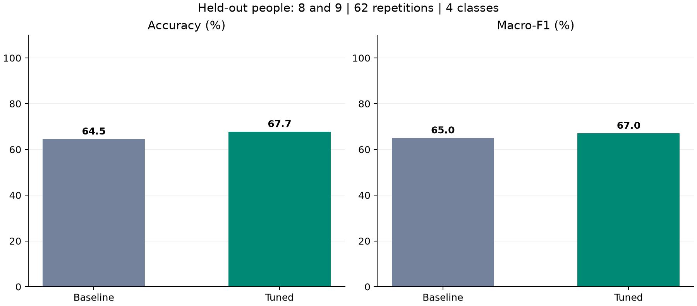
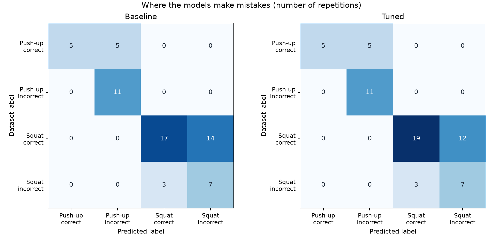

# Исследование: распознавание упражнений и меток выполнения

Это отдельная исследовательская часть для **Assignment #2, вариант A**: публичный набор данных, обучение модели, изменение её параметров и сравнение результатов. Код фитнес-тренера в родительской папке работает отдельно.

**Камера для этого эксперимента не нужна. LLM здесь нет.** Обучается небольшой Random Forest: несколько деревьев решений совместно выбирают ответ по числовым признакам позы.

## Что модель определяет

Четыре метки: правильное отжимание, неправильное отжимание, правильное приседание, неправильное приседание. «Правильность» означает совпадение с разметкой авторов датасета, а не подтверждение безопасности движения.

## Полученные результаты

На итоговом тесте **62 повторения двух людей, которых не было в обучении**:

| Показатель | Исходная модель | Модель после подбора параметров |
| --- | ---: | ---: |
| Верных ответов из 62 по четырём меткам | 40 | 42 |
| Accuracy по четырём меткам | 64,5% | 67,7% |
| Macro-F1 | 0,650 | 0,670 |
| Только различение упражнения: приседание / отжимание | 100% | 100% |

Итоговое улучшение Accuracy — **3,2 процентного пункта**, или два дополнительных правильных ответа. Ошибки остались в определении меток выполнения. Результат небольшой; на двух людях нельзя доказать устойчивое преимущество для всех пользователей. На участнике 8 результат вырос с 17/28 до 20/28, на участнике 9 снизился с 23/34 до 22/34.





## Быстрый запуск

Открой терминал **в этой папке `research`**, в отдельном Python-окружении. Протестировано с Python 3.12.14. Один раз установи зависимости:

```powershell
python -m venv .venv
.\.venv\Scripts\python.exe -m pip install -r requirements.txt
```

Показать ответ уже обученной модели на первом отложенном примере:

```powershell
.\.venv\Scripts\python.exe demo.py
```

Другой пример: `demo.py --index 10` (индексы от 0 до 61). Программа показывает метку авторов, ответ модели и совпадение. Это примеры готового датасета, а не съёмка с камеры.

Повторить обучение, сравнение и построение графиков:

```powershell
.\.venv\Scripts\python.exe train.py
.\.venv\Scripts\python.exe plot_results.py
.\.venv\Scripts\python.exe verify.py
```

Для обычного повторного обучения интернет не нужен: компактная таблица признаков включена в проект. Чтобы заново получить признаки из исходных координат, запусти `train.py --rebuild-features`: понадобятся интернет и примерно 25 МБ для загрузки. Зависимости устанавливаются один раз отдельно от окружения тренера. Сохранённые результаты уже есть — запускать обучение ради просмотра графиков не нужно.

## Откуда данные

REHAB24-6, опубликованный исследователями набор движений для задач анализа упражнений. Использованы готовые 3D-скелеты из MoCap, преобразованные в CSV сторонним открытым репозиторием. Исходные видео и MediaPipe для этого эксперимента не запускаются. Отжимания в исходном наборе выполняются с руками на столе.

Из 302 повторений (31 427 кадров) исключены 15, помеченные авторами как ошибки MoCap. Осталось **287 повторений, 29 789 кадров**. Ошибочные выполнения упражнений НЕ исключались: они нужны как примеры класса incorrect.

Источники, закреплённая версия, проверки происхождения и условия академического использования подробно указаны в [SOURCES.md](SOURCES.md). Это сторонние данные; мы не заявляем, что сами их снимали.

## Как работает эксперимент

1. В каждом кадре вычисляем 8 углов: локоть, плечо, таз и колено с двух сторон. Дополняем наклоном корпуса и расстояниями между кистями, коленями и лодыжками.
2. Координаты центрируем по тазу и делим на длину корпуса, чтобы уменьшить влияние положения и размера тела. Два тазовых столбца в этих данных соответствуют одной центральной точке, а не двум отдельным тазобедренным суставам.
3. Для каждого из 12 показателей за полный повтор берём среднее, разброс, минимум и максимум. Получаем **48 числовых признаков**. Один полный повтор становится одной строкой.
4. **225 повторений людей 1–7 и 10** используются для разработки. Люди **8 и 9 (62 повтора)** заранее отложены для окончательного теста. Записи одного человека не пересекают границу обучения и теста.
5. Исходная модель: Random Forest с 50 деревьями, глубиной до 3 и минимумом 3 примеров в листе. Используются сбалансированные веса классов и фиксированное случайное зерно 42.
6. Перебираем 12 настроек: 50/150 деревьев, глубина 3/6/без ограничения, минимум 1/3 примера в листе. На каждом шаге один человек из обучающей части временно становится проверочным — всего 8 разбиений. Параметры выбираются по среднему Macro-F1. Итоговый тест для этого не используется.
7. Выбранный вариант: **50 деревьев, глубина без ограничения, минимум 3 примера в листе**. Поэтому итоговое отличие от исходной модели — снятие ограничения глубины. Macro-F1 при подборе вырос с 0,639 до 0,708.
8. Обе модели обучаются на одинаковых 225 примерах и один раз сравниваются на одинаковых 62 отложенных примерах. Сохраняются все предсказания, результаты и выбранная модель.

Accuracy — доля полностью правильных ответов. Macro-F1 — средняя оценка качества по классам, чтобы большой класс не скрывал ошибки на маленьком. В отдельных проверочных разбиениях могут присутствовать не все четыре класса; F1 считается по меткам, которые есть в ответах или разметке данного разбиения.

## Что сделано нами

Взяли сторонние данные, проверили метки и номера участников, подготовили признаки, обучили исходную модель, изменили параметры, проверили выбранный вариант на новых людях, сохранили результаты и ограничения. Это собственный учебный эксперимент с AI-помощью, а не обучение готовой MediaPipe или YOLO.

## Ограничения

- Проверка всего на двух новых людях: возможна высокая зависимость от конкретного участника. Прирост не объявляется статистически значимым.
- Обученная модель на обучающих примерах даёт 100%, на тестовых — 67,7%: переобучение остаётся существенным.
- Данные MoCap качественнее точек с обычной камеры; перенос на веб-камеру ещё не проверен.
- Вся последовательность заранее разделена на повторы авторами датасета. Автоматическая нарезка видео и подсчёт повторений этой моделью не оценивались.
- Одна метка incorrect объединяет разные ошибки; модель не объясняет причину ошибки и не заменяет тренера.
- Все пороги существующих счётчиков и их проверка с камерой относятся к другой части проекта.

## Где что находится

| Файл | Назначение |
| --- | --- |
| `download_data.py` | Загрузка закреплённых файлов с проверкой SHA-256 |
| `features.py` | Проверка данных и вычисление признаков |
| `train.py` | Обучение, подбор параметров и итоговый тест |
| `demo.py` | Демонстрация сохранённой модели без камеры |
| `verify.py` | Проверки разделения, происхождения и результатов |
| `plot_results.py` | Графики из сохранённых измерений |
| `data/features.csv` | Компактная таблица 287 примеров |
| `results/model.joblib` | Собственная обученная модель |
| `results/metrics.json` | Точные метрики и версии библиотек |
| `results/validation_search.json` | Все варианты и результаты подбора |
| `results/predictions.csv` | Каждый ответ на итоговом тесте |
| `results/split_manifest.csv` | Разделение примеров по людям |
| `ЗАЩИТА.md` | Объяснение и план выступления |
